<p align="center">
  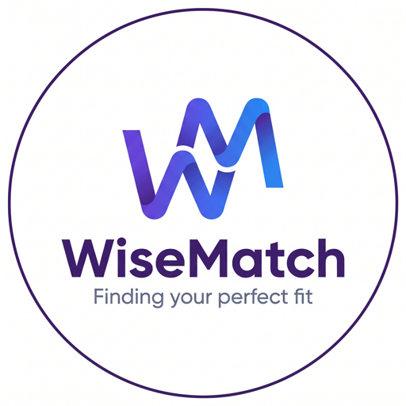
</p>

<h1 align="center">WiseMatch: Taste-First Roommate Matching Engine</h1>
<h3 align="center">Agentic Roommate Discovery & Compatibility Ranking for Bangalore</h3>

I have developed WiseMatch, an agent-driven roommate discovery platform engineered for people who are moving to, or within, Bangalore. Instead of handing the user a fifty-field questionnaire, the system dynamically decides the single most useful question to ask next, narrows a pool of 650+ candidate roommates down in a handful of answers, and ranks whoever is left with a transparent compatibility score. Once two people look like a good fit, they can message each other through an Instagram-style request system, so they get to know each other properly before anyone signs a lease.

<p align="center">
  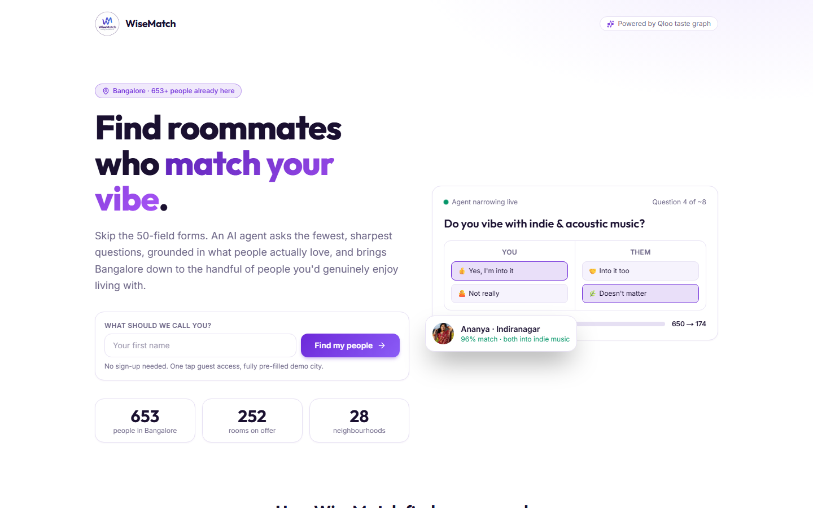
</p>

## 🚀 Live Deployment

[](https://getwisematch.vercel.app)

> The API runs on a free Render instance, so the very first request after a quiet spell can take around 30 seconds while it wakes up. After that it is quick.

## 🎬 Demo Video

<p align="center">
  <video src="image/WiseMatch_Demo.mp4" controls muted width="100%"></video>
</p>

> If the player does not load in your browser, [watch the demo video here](image/WiseMatch_Demo.mp4).

## 🖼️ A Quick Look

| Agent Onboarding | Discover |
| :---: | :---: |
| 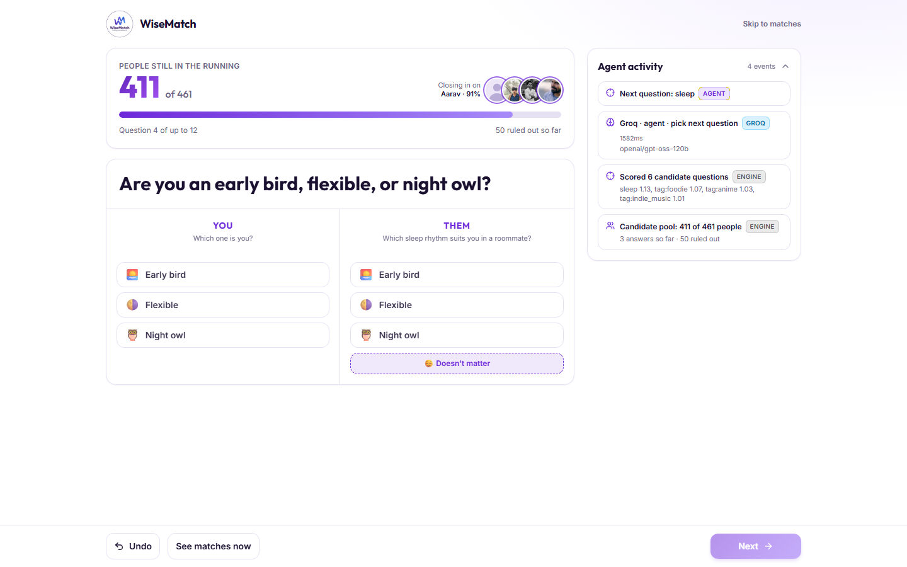 | 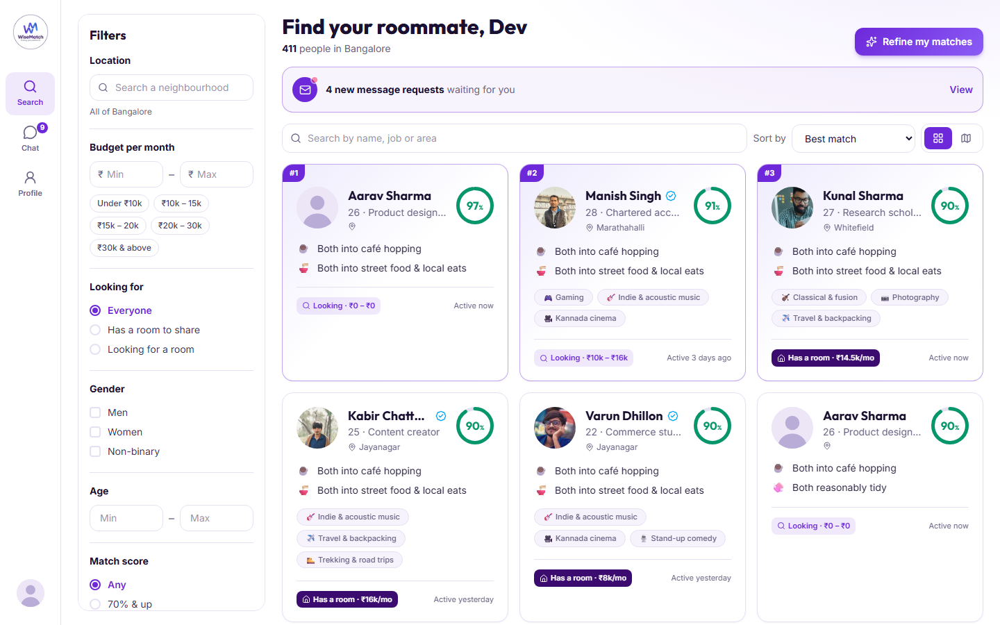 |
| **Match Profile** | **Message Requests** |
| 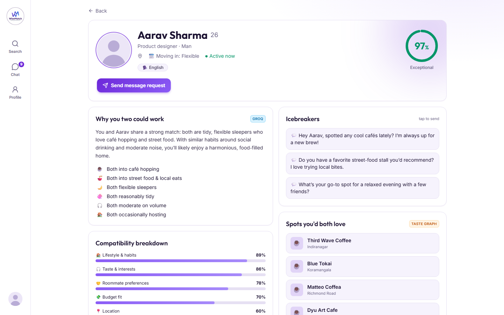 | 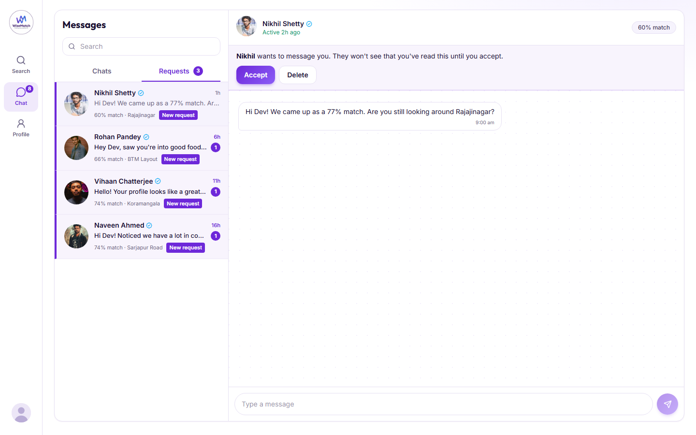 |

## 💡 Why I Built This

Finding a flatmate in a big city is mostly guesswork. Listing sites screen people on rent and location, but flatmates rarely fall out over rent. They fall out over the music at midnight, the cooking smells, the guests on a weeknight, or the simple fact that one person is an early bird and the other is not. Existing apps try to solve this with a long form that most people skip halfway through, and a form can never really capture a vibe.

WiseMatch tackles it from the opposite direction. It treats the whole city as a pool of candidates, and every answer you give is used to remove people or reshape the ranking, so the questions you are asked are the ones that matter most for the people who are actually left.

## 🧩 Challenges I Faced While Ideating

Things did not work the first time, and a few of these shaped the final design:

- **Too many questions kill onboarding.** My first instinct was a proper preference form. It felt like homework. That pushed me towards the Akinator idea: always ask the question that splits the remaining people most evenly, and stop early.
- **One wrong tap should not delete a great match.** If every answer removed people outright, a single misclick could exclude someone perfect. So only real deal-breakers (diet, smoking, drinking, gender preference) remove people. Everything else only softens the score.
- **Scores that looked too good to be true.** In early tests a single shared trait produced a 98% match. I added evidence shrinkage so scores start modest and climb as the agent genuinely learns more about you.
- **The empty-app problem.** A roommate platform with five users feels dead. I generated 650 believable Bangalore profiles across 28 neighbourhoods, with room listings, habits and taste, so the product can be judged end to end on day one.
- **Likes felt awkward for flatmates.** A mutual-like model added friction nobody needed, so I replaced it with message requests that the other person can accept or delete.
- **Building against an API I could not see yet.** The taste service's response fields were not confirmed while I was building, so the client parses defensively and falls back to a bundled taste catalog with the same shape. The app never breaks if the live service is slow or unavailable.
- **SQLite forgives, Postgres does not.** The app worked perfectly on a local SQLite file and then failed on Neon because one column was a character too short. A small thing, but it taught me to test against the real database early.

## 💾 Architecture & Components

The application is divided into decoupled layers, each with a single job:

**Frontend Directory:**
Next.js (App Router) with React and Tailwind CSS, delivered as a fully responsive single-page experience that behaves like a mobile app on a phone (bottom tab bar) and like a dashboard on a desktop (icon rail and filter sidebar). It covers the You / Them onboarding flow, Amazon-style filters and sorting, the match profile pages, the Chats / Requests inbox and a Leaflet map of Bangalore.

**Backend Services:**
FastAPI and Uvicorn, an asynchronous Python API with Pydantic validation, signed JWT sessions for guest access, and a matching engine that keeps the profile pool in memory so every question can be scored across 650 people in a few milliseconds.

**Database Layer:**
PostgreSQL on Neon (serverless), accessed through SQLAlchemy. Profiles, listings, conversations and messages live here. Flexible, fast-changing data such as habits, preferences, taste entities and the onboarding log is stored as JSON columns. For local development it falls back to a SQLite file with no setup.

**Agentic AI Core:**
Groq (`openai/gpt-oss-120b`) is the language model behind the agents. A deterministic matching engine does the maths, and the model is used where judgement and language matter: choosing and phrasing the next question, explaining why two people match, and playing the demo profiles in chat.

**Taste Intelligence:**
A taste-graph layer supplies the example entities shown on taste questions, powers the favourites search, and produces the "spots you would both love" for a matched pair. When a taste-graph API key is configured these are live calls. Without one, the same shapes come from a bundled catalog so the product keeps working.

<p align="center">
  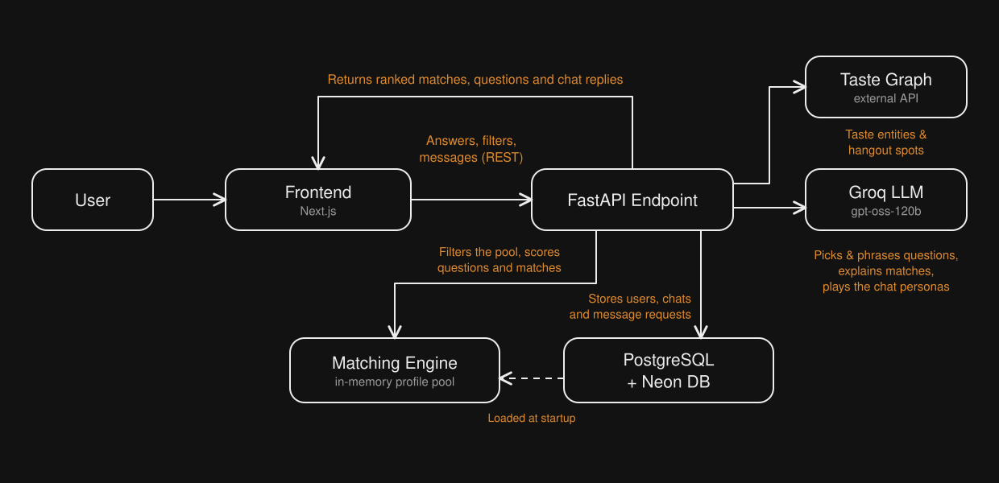
</p>

## 📖 Agentic AI Orchestration & Logic

Asking a language model to pick roommates from 650 profiles in one big prompt is slow, expensive, and prone to inventing details. WiseMatch avoids that by splitting the work. The arithmetic of narrowing a pool is done by a deterministic engine, and the model is only asked to make the decisions that need language and taste.

### The Specialised Agent Mesh

On every turn, the orchestrator runs four specialised roles in order:

- **Pool Analyst:** reads the live candidate pool after every hard filter and answer so far.
- **Question Scorer:** scores every possible question, both lifestyle and taste, by how evenly it would split that pool.
- **Taste Scout:** for taste questions, pulls example entities from the taste graph so the question feels concrete ("e.g. Third Wave Coffee, Blue Tokai").
- **Question Strategist:** the Groq model picks the best candidate and phrases it in a friendly, human way.

Two more agents serve the rest of the product:

- **Match Explainer:** writes the short "why you two could work" summary and the icebreakers from real shared tastes and habits, never invented ones.
- **Persona Replier:** plays each seeded profile in chat, in character, so conversations feel alive during a demo. If you ask it directly whether it is real, it says it is a demo profile.

<p align="center">
  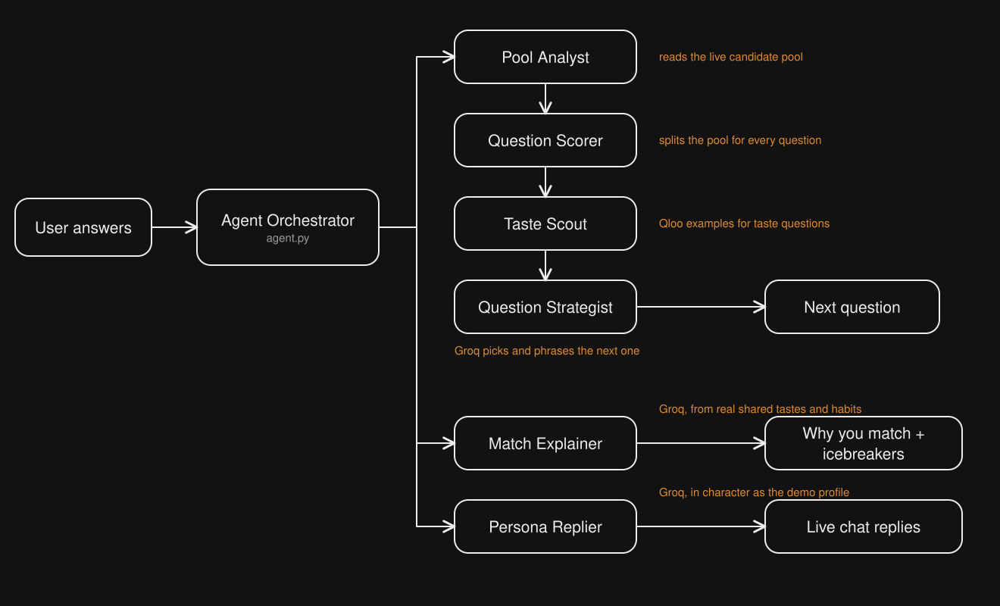
</p>

### The Akinator Loop

The idea is simple. Suppose 100 people in Bangalore are still in the running and half of them are gamers. Asking "do you like gaming?" would split the pool close to 50 / 50, which makes it the most useful question to ask, so the agent asks that. After you answer, the pool shrinks, the scores are recalculated on the people who are left, and the next question is chosen from scratch. It repeats until the pool is small (8 people) or 12 questions have been asked, and you can jump to your matches at any point.

For every question the user answers twice, once for **You** and once for **Them**, always as a single choice, with "Doesn't matter" as the default.

<p align="center">
  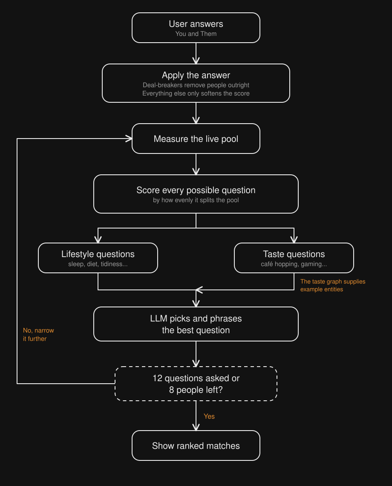
</p>

### Hard Filters and Soft Scores

To keep the process fair and transparent, answers are treated in two different ways:

- **Deal-breakers remove people outright:** diet, smoking, drinking, and gender preference, enforced in both directions (a person who only wants a female flatmate never sees a male user either). Two people who both already have a room are never paired.
- **Everything else only softens the score:** sleep rhythm, tidiness, noise, guests, pets, social energy, cooking, work setup and taste.

### Compatibility Score

Every remaining person is scored out of 100 from five dimensions:

| Dimension | Weight | What it looks at |
| --- | :---: | --- |
| Lifestyle & habits | 35% | How close your day-to-day habits are |
| Taste & interests | 30% | Shared tags and shared favourite entities |
| Roommate preferences | 15% | Whether each of you fits what the other asked for |
| Budget fit | 10% | Overlap of budgets or rent |
| Location | 10% | Distance, once you have picked an area |

With only a few answers on record, the score stays close to neutral. It only climbs towards the nineties once the agent actually knows enough about both people. Every score comes with its reasons, so you can always see exactly why someone ranks where they do.

## 🔄 System Workflow

<p align="center">
  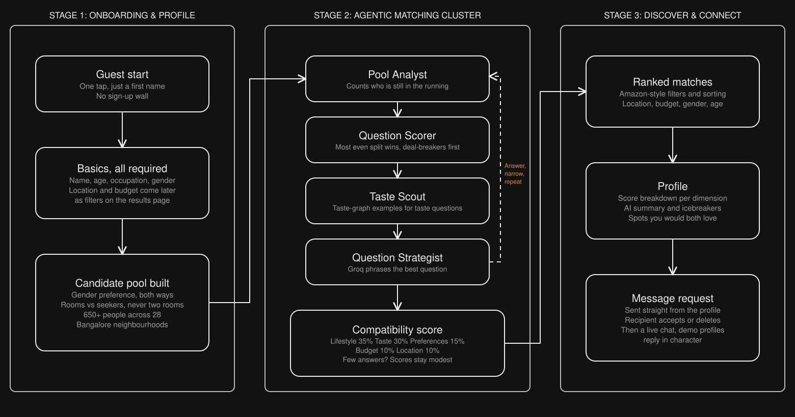
</p>

**Stage 1: Onboarding & Profile.** A guest starts with just a first name, then gives four required basics (name, age, occupation and gender). Location and budget are deliberately not asked here. They become filters on the results page, the way you narrow products on a shopping site.

**Stage 2: Agentic Matching Cluster.** The loop above runs until the pool is small enough, and every remaining person gets a compatibility score.

**Stage 3: Discover & Connect.** Matches appear with filters for location, budget, gender, age and match score, plus sorting. A profile shows the score breakdown, an AI summary, icebreakers and spots you would both love. From there you can send a message request straight away.

### Message Requests

Instead of a like-and-match system, WiseMatch works like Instagram's inbox. You can send anyone a first message, which lands in their **Requests** tab, highlighted with a count badge, a tinted row and a "New request" tag. They can accept it (and the chat opens up) or delete it. Until they accept, you can only send the one message. The seeded demo profiles accept most requests within a few seconds, a little more eagerly for strong matches, and then reply live.

## 🗄️ Data Model

<p align="center">
  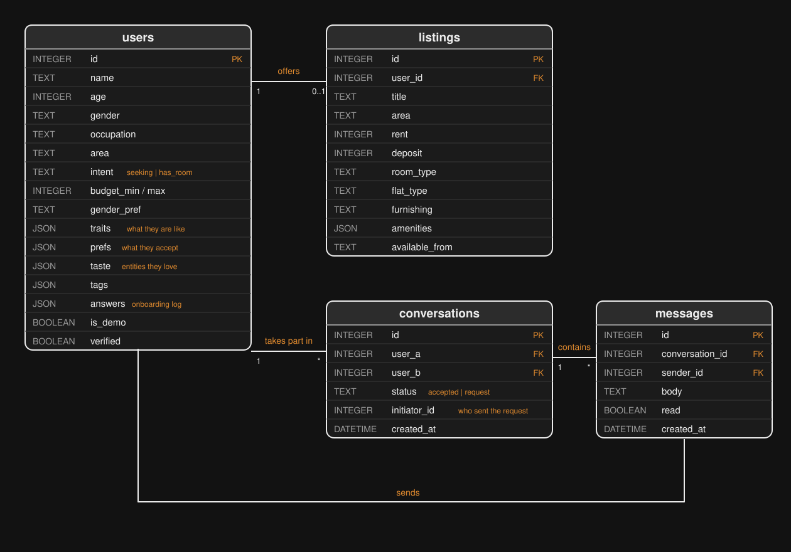
</p>

The relational core is intentionally small: `users`, `listings`, `conversations` and `messages`. Habits, preferences, taste entities, tags and the onboarding log sit in JSON columns on the user, because they change shape as the agent learns new things. A conversation has a `status` (`accepted` or `request`) and an `initiator_id`, which is all the message-request system needs. At startup the profiles are mirrored into memory, which keeps question scoring fast and writes go straight back to the database.

## 🧪 About the Demo Data

- The 650 profiles are **fictional**, generated with correlated habits, tastes and budgets across 28 Bangalore neighbourhoods (252 of them offer a room).
- Profile photos are free-to-use stock portraits from [Pexels](https://www.pexels.com/license/). People who register themselves get no photo and see the standard silhouette instead.
- Demo profiles reply through the language model and say so if asked directly.
- Chat refreshes by short polling every few seconds, not websockets. It is simple, and plenty for this scale.

## 🛠️ Tech Stack

| Layer | Technology |
| --- | --- |
| Frontend | Next.js 16, React 19, Tailwind CSS v4, Leaflet |
| Backend | FastAPI, Uvicorn, SQLAlchemy 2, httpx, PyJWT |
| Database | Neon (PostgreSQL), SQLite for local development |
| Language model | Groq, `openai/gpt-oss-120b` |
| Taste graph | External taste API, with a bundled offline fallback |
| Hosting | Vercel (frontend), Render (backend) |

## ⚙️ Run It Locally

**1. Backend**

```bash
cd backend
python -m venv .venv
.venv/Scripts/activate          # on macOS / Linux: source .venv/bin/activate
pip install -r requirements.txt
cp .env.example .env            # then fill in your keys
uvicorn app.main:app --port 8000
```

On first start the API creates the tables and seeds 650 Bangalore profiles. To reseed at any time: `python -m app.seed --reset`.

| Variable | What it is for |
| --- | --- |
| `DATABASE_URL` | Neon connection string. Leave it empty to use a local SQLite file. |
| `GROQ_API_KEY` | Groq key for the agents. Without it, questions are picked by score alone and chat replies are canned. |
| `GROQ_MODEL` | Defaults to `openai/gpt-oss-120b`. |
| `JWT_SECRET` | Any long random string. |
| `CORS_ORIGINS` | Comma-separated frontend origins. |

**2. Frontend**

```bash
cd frontend
npm install
cp .env.example .env.local      # NEXT_PUBLIC_API_URL=http://localhost:8000
npm run dev
```

Open http://localhost:3000. Guest access is one tap and everything is pre-filled.

> The backend keeps the profile pool in memory, so run a single instance rather than several workers.

## 📁 Project Structure

```
backend/app
  agent.py      question selection, answers, match explanations, chat personas
  engine.py     hard filters, split scoring, compatibility model
  llm.py        Groq client
  api.py        REST endpoints (auth, agent, matches, chat, requests)
  seed.py       650-profile Bangalore generator
  catalog.py    areas, taste graph, question bank, photo list
frontend/src
  app/          landing, basics, agent onboarding, discover, profile, chat, settings
  components/   shell, match cards, map, agent activity feed
image/          screenshots and architecture diagrams used in this README
```

## 🗺️ What's Next

- Move the taste layer fully onto live calls to the external taste-graph API.
- Real sign-in (Google OAuth) in place of guest sessions, along with blocking and reporting.
- Photo uploads for rooms and profiles.
- Learning from the accepts and declines to improve the ranking over time.
- Websockets for chat, and support for more cities and languages.

## 📜 License

Released under the [MIT License](LICENSE).
